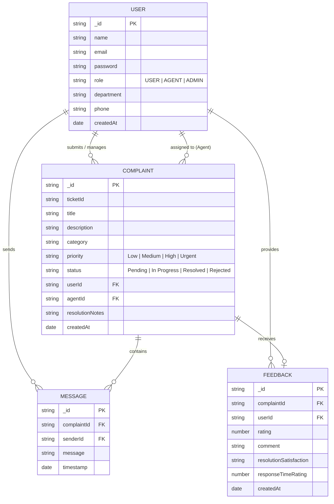

# 🎫 SkillWallet — Complaint Management & Transparency System

**SkillWallet** is your one-stop destination for effortless complaint management and resolution. Designed and implemented with clean MERN Stack architecture (MongoDB, Express, React Vite, Node.js) and modern **Glassmorphism UI** visual design aesthetics.

---

## DEMO AND GITHUB REPOSITORY LINKS

> [!IMPORTANT]
> - 📂 **Google Drive Resources**: https://drive.google.com/drive/folders/14pZfqHlber7IrIwkIBYtW5BlLwQ78jCa?usp=sharing
> - 🐙 **GitHub Repository**: https://github.com/Nitheesh2304/nitheesh
> - 🔑 **Pre-configured Demo Accounts**:
>   - **Admin Account Email**: `admin@complaint.com` | **Password**: `password123`
>   - **Agent Account Email**: `agent@complaint.com` | **Password**: `password123`
>   - **User Account Email**: `user@complaint.com` | **Password**: `password123`

---

# 1. PROJECT ARCHITECTURE

## TECHNICAL ARCHITECTURE

The application follows a decoupled client-server architecture:

```
+-----------------------------------------------------------------------+
|                            FRONTEND LAYER                             |
|  - React 18 (Vite)                                                    |
|  - Glassmorphism Design Tokens & Vanilla CSS System                   |
|  - Context API (AuthContext, ComplaintContext)                        |
|  - React Router DOM Navigation                                        |
|  - Pages: Home, Login, Register, User Dashboard, Agent Dashboard,     |
|    Admin Dashboard, Complaint Details, Feedback                       |
+-----------------------------------------------------------------------+
                                   |
                                   | REST API (HTTP / JSON / JWT)
                                   v
+-----------------------------------------------------------------------+
|                            BACKEND LAYER                              |
|  - Node.js & Express.js REST API Server                               |
|  - JWT Authentication & Bcrypt Hashing Middleware                     |
|  - Controllers: AuthController, ComplaintController, AgentController, |
|    AdminController, ChatController, FeedbackController                |
+-----------------------------------------------------------------------+
                                   |
                                   | Mongoose ORM
                                   v
+-----------------------------------------------------------------------+
|                            DATABASE LAYER                             |
|  - MongoDB (Users, Complaints, Messages, Feedback)                    |
+-----------------------------------------------------------------------+
```

---

## ER DIAGRAM



---

## FEATURES

1. **Comprehensive Complaint Lifecycle Management**: End-to-end tracking of complaints from submission (`Pending`) to agent assignment (`In Progress`), resolution (`Resolved`), or rejection with full history audit logs.
2. **Role-Based Access Control (RBAC)**: Dedicated permissions and tailored dashboards for **Users**, **Agents**, and **Admins**.
3. **Interactive Complaint Chat & Messaging**: Direct line of communication between users and assigned agents for real-time ticket updates and resolution details.
4. **Feedback & Rating System**: Post-resolution satisfaction ratings (1-5 stars) and qualitative feedback collected to measure service performance.
5. **Unified Admin Console (`admin@complaint.com` / `password123`)**:
   - Overall system analytics & metrics tracking.
   - User & Agent account management.
   - Intelligent ticket triage & agent assignment controls.
6. **Glassmorphism UI Aesthetics**: Responsive interface built with custom CSS variables, sleek dark visual elements, smooth micro-animations, and instant feedback notifications.

---

## 🛠️ Tech Stack

### Frontend
| Technology | Version |
|------------|---------|
| React | ^18.3.1 |
| Vite | ^5.2.11 |
| React Router DOM | ^6.23.1 |
| Axios | ^1.7.2 |
| Lucide React (Icons) | ^0.395.0 |

### Backend
| Technology | Version |
|------------|---------|
| Node.js | ES Modules |
| Express | ^4.19.2 |
| MongoDB + Mongoose | ^8.4.1 |
| JWT (Authentication) | ^9.0.2 |
| Bcryptjs (Passwords) | ^2.4.3 |
| Nodemailer (Email) | ^6.9.13 |
| Helmet (Security) | ^7.1.0 |
| Express Validator | ^7.1.0 |

---

## 📁 Project Structure

```
skillwallet/
├── server/
│   ├── config/
│   │   └── db.js                  # MongoDB connection & diagnostics
│   ├── controllers/
│   │   ├── authController.js      # Register / Login / JWT
│   │   ├── complaintController.js # Complaint CRUD
│   │   ├── agentController.js     # Agent operations
│   │   ├── adminController.js     # Admin operations
│   │   ├── chatController.js      # Chat/messaging
│   │   └── feedbackController.js  # Feedback handling
│   ├── middleware/
│   │   ├── authMiddleware.js      # JWT verification & role guard
│   │   ├── errorMiddleware.js     # Global error handler
│   │   └── validateMiddleware.js  # Request validation
│   ├── models/
│   │   ├── User.js
│   │   ├── Complaint.js
│   │   ├── Message.js
│   │   └── Feedback.js
│   ├── routes/
│   │   ├── authRoutes.js
│   │   ├── complaintRoutes.js
│   │   ├── agentRoutes.js
│   │   ├── adminRoutes.js
│   │   ├── chatRoutes.js
│   │   └── feedbackRoutes.js
│   ├── utils/
│   │   ├── mailer.js              # Email utility
│   │   └── seed.js                # Database seeder
│   ├── server.js                  # Express entry point
│   └── .env                       # Environment variables
│
└── client/
    ├── src/
    │   ├── components/
    │   │   ├── Navbar.jsx
    │   │   ├── Footer.jsx
    │   │   ├── ProtectedRoute.jsx
    │   │   ├── StatusBadge.jsx
    │   │   └── PriorityBadge.jsx
    │   ├── context/
    │   │   ├── AuthContext.jsx     # Auth state management
    │   │   └── ComplaintContext.jsx
    │   ├── pages/
    │   │   ├── HomePage.jsx
    │   │   ├── LoginPage.jsx
    │   │   ├── RegisterPage.jsx
    │   │   ├── UserDashboard.jsx
    │   │   ├── AgentDashboard.jsx
    │   │   ├── AdminDashboard.jsx
    │   │   ├── ComplaintDetailsPage.jsx
    │   │   └── FeedbackPage.jsx
    │   ├── services/
    │   │   └── api.js              # Axios API instance
    │   ├── App.jsx
    │   └── main.jsx
    └── index.html
```

---

## 🚀 Getting Started

### Prerequisites
- [Node.js](https://nodejs.org/) v18+
- [MongoDB](https://www.mongodb.com/) (local or MongoDB Atlas)
- Git

### 1. Clone the Repository

```bash
git clone https://github.com/Nitheesh2304/nitheesh.git
cd nitheesh
```

### 2. Setup Server (Backend)

```bash
cd server
npm install
```

Create a `.env` file in the `server/` directory:

```env
PORT=5000
MONGO_URI=your_mongodb_connection_string
JWT_SECRET=your_jwt_secret_key
EMAIL_USER=your_email@gmail.com
EMAIL_PASS=your_email_app_password
```

Start the server:

```bash
# Development mode (with nodemon)
npm run dev

# Seed Database with sample users & complaints
npm run seed

# Production
npm start
```

### 3. Setup Client (Frontend)

```bash
cd client
npm install
npm run dev
```

---

## 📡 API Endpoints

| Method | Endpoint | Description | Access |
|--------|----------|-------------|--------|
| POST | `/api/auth/register` | Register new user | Public |
| POST | `/api/auth/login` | Login & receive JWT | Public |
| GET | `/api/complaints` | Get user complaints | Authenticated |
| POST | `/api/complaints` | Submit new complaint | USER |
| GET | `/api/complaints/:id` | Get complaint details | Authenticated |
| PUT | `/api/complaints/:id` | Update complaint status | AGENT / ADMIN |
| GET | `/api/agents` | Get all agents | ADMIN |
| GET | `/api/admin` | Admin dashboard data | ADMIN |
| POST | `/api/chat` | Send chat message | Authenticated |
| POST | `/api/feedback/:id` | Submit feedback | USER |
| GET | `/api/health` | System health check | Public |

---

## 👨‍💻 Author

**Nitheesh** — [@Nitheesh2304](https://github.com/Nitheesh2304)

---

## 📄 License

This project is open source and available under the [MIT License](LICENSE).
